# ⚔️ BLUE SHADOW MONARCH HQ

> **Blue-themed personal engineering command center** — a map of the systems, products, and experiments I'm building.

## 🧭 Choose your domain

### 01 — Software Engineering
*Designing applications and turning requirements into usable products.*

| Project | Focus | Repository |
|---|---|---|
| Educational Platform | Courses, exams, enrollment, and role-based workflows for teachers, students, parents, and admins | [Open repository](https://github.com/OmarGhamry/Educational-Platform) |
| AERO Commerce | Interactive luxury-audio storefront front end; checkout and cart are currently simulated | [Open repository](https://github.com/OmarGhamry/Aero-commerce) |
| Movie Ticket Management | Java desktop application project | [Open repository](https://github.com/OmarGhamry/Movieticket) |

### 02 — Data & Intelligence
*Exploring datasets, building dashboards, and experimenting with predictive models.*

| Project | Focus | Repository |
|---|---|---|
| Data Job Dashboard | Power BI exploration of job-market data, including modeling, DAX, and interactive reports | [Open repository](https://github.com/OmarGhamry/Data-Job-Dashboard) |
| FocusDNA ML | Machine-learning project exploring focus/session outcomes | [Open repository](https://github.com/OmarGhamry/HCIA_FocusDNA_ML) |
| Netflix Dashboard | Content-catalog analysis | [Open repository](https://github.com/OmarGhamry/Netflix_DashBoasrd) |
| Cars Sales | Exploratory analysis of car-sales data | [Open repository](https://github.com/OmarGhamry/Cars_sales_Project) |

### 03 — Systems & Hardware
*Connecting software logic to physical behavior and digital architecture.*

| Project | Focus | Repository |
|---|---|---|
| Smart Elevator | Four-floor model, request scheduling, sensor-based floor detection, motor control, and safety planning | [Open repository](https://github.com/OmarGhamry/Smart-Elevator-Control-System) |
| Cryptographic Coprocessor | Hardware-oriented cryptographic design | [Open repository](https://github.com/OmarGhamry/Cryptographic_Coprocessor) |
| Hardware Tasks | Engineering and hardware practice repository | [Open repository](https://github.com/OmarGhamry/hardware-tasks) |

## 🏅 Milestone archive

These are project-based milestones, not rankings or claims of professional certification.

- **Product Builder** — worked on application projects spanning web and desktop development.
- **Data Storyteller** — built interactive Power BI dashboards and explored data workflows.
- **ML Explorer** — completed a machine-learning project focused on focus/session outcomes.
- **Embedded Systems Explorer** — designed a sensor- and motor-based elevator control project.
- **Digital Design Contributor** — contributed to a cryptographic coprocessor project.

## 🧪 Engineering principles

1. **Understand before implementing.** Make requirements and interfaces explicit.
2. **Build in small increments.** Prefer focused changes that can be tested.
3. **Document decisions.** A repository should explain how to run it and why it exists.
4. **Be honest about status.** Planned, simulated, and production-ready are different things.
5. **Keep learning visible.** Every project should show what was learned and what comes next.

## 🛰️ Current focus

- Advancing the Smart Elevator Control System from system design toward implementation and verification.
- Growing full-stack skills around C#, ASP.NET Core, SQL, and front-end development.
- Strengthening practical data and machine-learning foundations.

---

**THE BLUE SYSTEM IS ONLINE. THE PLAYER IS STILL LEVELING UP.**

[GitHub Profile](https://github.com/OmarGhamry) · [Portfolio](https://omarghamry.github.io/Omar_portfolio/)

