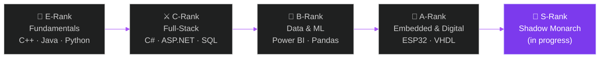

<!-- ═══════════════════ HEADER ═══════════════════ -->
<div align="center">


<a href="https://github.com/OmarGhamry">
  
</a>

<br/>

<a href="https://omarghamry.github.io/Omar_portfolio/"></a>
<a href="https://github.com/OmarGhamry?tab=repositories"></a>
<a href="https://github.com/OmarGhamry?tab=followers"></a>


</div>

<br/>

<!-- ═══════════════════ STATUS WINDOW ═══════════════════ -->
## 🟣 `[ STATUS WINDOW ]`

<table>
<tr>
<td width="56%" valign="top">

```text
╔════════════════════════════════════════╗
║            [ S T A T U S ]             ║
╠════════════════════════════════════════╣
║ NAME    : Omar Ghamry                  ║
║ JOB     : Engineer (in training)       ║
║ GUILD   : Zagazig University           ║
║ MAJOR   : Computer & Systems Eng.      ║
║ RANK    : E ──────────────────▶ S      ║
║ TITLE   : The Relentless Learner       ║
╠════════════════════════════════════════╣
║ STR  Backend ········ C# / ASP.NET     ║
║ INT  Data ··········· Python / Power BI║
║ AGI  Frontend ······· React / JS       ║
║ SEN  Hardware ······· ESP32 / VHDL     ║
╚════════════════════════════════════════╝
```

</td>
<td width="44%" valign="top">

### 📜 Active Quests

- ⚔️ Master **ASP.NET Core** full-stack development
- 🧠 Train the **machine learning** skill tree
- 📊 Clear data dungeons with **Power BI & Python**
- 🔌 Conquer **embedded & digital design** raids

### ⏳ Daily Quest

> `[ ] Write code` &nbsp; `[ ] Ship something` &nbsp; `[ ] Learn one new thing`
>
> **Penalty for skipping: none. But the XP is worth it.**

</td>
</tr>
</table>

<br/>

<!-- ═══════════════════ SHADOW ARMY ═══════════════════ -->
## 🌑 Shadow Army &nbsp;·&nbsp; *Tech Arsenal*

<div align="center">

| | |
|:---:|:---|
| **⚔️ Languages** |  |
| **🏰 Web & Frameworks** |  |
| **🗄️ Vaults (Databases)** |  |
| **🔮 Data & ML Magic** |     |
| **🔌 Hardware Relics** |    |
| **🛡️ Equipment** |  |

</div>

<br/>

<!-- ═══════════════════ DUNGEONS ═══════════════════ -->
## 🏰 Dungeons Cleared &nbsp;·&nbsp; *Featured Projects*

<div align="center">

<a href="https://github.com/OmarGhamry/Educational-Platform">
  
</a>
<a href="https://github.com/OmarGhamry/Smart-Elevator-Control-System">
  
</a>
<a href="https://github.com/OmarGhamry/Data-Job-Dashboard">
  
</a>
<a href="https://github.com/OmarGhamry/HCIA_FocusDNA_ML">
  
</a>
<a href="https://github.com/OmarGhamry/Netflix_DashBoasrd">
  
</a>
<a href="https://github.com/OmarGhamry/Cryptographic_Coprocessor">
  
</a>

</div>

<details>
<summary><b>📖 Open the Quest Log (what each dungeon was about)</b></summary>

<br/>

| | Dungeon | Objective | Gear used |
|:-:|---|---|---|
| 🎓 | **Educational Platform** | Courses, exams and student features in one web app | `ASP.NET Core` `C#` `SQL` |
| 🛗 | **Smart Elevator Control** | Elevator simulation with request scheduling and safety logic | `ESP32` `Arduino` `Embedded C/C++` |
| 💼 | **Data Job Dashboard** | Interactive view of the data job market | `Power BI` `DAX` `Power Query` |
| 🧠 | **FocusDNA ML** | ML analysis of focus and session-success data | `Python` `Pandas` `Scikit-learn` |
| 🎬 | **Netflix Analysis** | Content trends across Netflix titles | `Power BI` `Data Analysis` |
| 🔐 | **Cryptographic Coprocessor** | A hardware-level cryptographic coprocessor | `VHDL` `Digital Design` |

</details>

<br/>

<!-- ═══════════════════ LEVEL-UP PATH ═══════════════════ -->
## 📈 Level-Up Path



<br/>

<!-- ═══════════════════ SNAKE ═══════════════════ -->
## 🐍 The Shadow Serpent

<div align="center">

<picture>
  <source media="(prefers-color-scheme: dark)" srcset="https://raw.githubusercontent.com/OmarGhamry/OmarGhamry/output/github-snake-dark.svg" />
  <source media="(prefers-color-scheme: light)" srcset="https://raw.githubusercontent.com/OmarGhamry/OmarGhamry/output/github-snake.svg" />
  
</picture>

</div>

<br/>

<!-- ═══════════════════ STATS ═══════════════════ -->
## 📊 Hunter Statistics

<div align="center">


</div>

<br/>

<!-- ═══════════════════ CONNECT ═══════════════════ -->
## 🤝 Join My Party

<div align="center">

Looking for a party member for a **collaboration, project or new idea**?<br/>
Send the invite. 👇

<br/>

<a href="https://omarghamry.github.io/Omar_portfolio/"></a>
<a href="https://github.com/OmarGhamry"></a>
<a href="http://www.linkedin.com/in/omarghamry"></a> 
<a href="mailto:omarghamry2005@gmail.com"></a> 

<br/><br/>

### 🌑 *ARISE.*


</div>
