<!--
  Omar Ghamry — GitHub profile
  Theme: Solo Leveling / Shadow Monarch
  Keep project links and contact details current as the portfolio evolves.
-->

 

---

## 🏰 BLUE SHADOW MONARCH HQ

One map for my software, data, and hardware engineering journey.

---

## 🔷 SYSTEM PROFILE

<table>
<tr>
<td width="58%" valign="top">

I'm **Omar Ghamry**, a Computer & Systems Engineering student at **Zagazig University**.

I enjoy working across software and engineering — from building web applications with **C# and ASP.NET Core**, to exploring **Data Analytics and Machine Learning**, and designing **embedded and digital systems**.

My approach is simple: learn by building, solve practical problems, and keep improving one project at a time.

**Current direction**
- Full-Stack Development — ASP.NET Core, React, SQL
- Data & Machine Learning — Python, Power BI, scikit-learn
- Embedded Systems — Arduino, ESP32, digital design

</td>
<td width="42%" valign="top">

### ⚔️ PLAYER STATUS

| Attribute | Status |
|:--|:--|
| **Class** | Engineer in Training |
| **Guild** | Zagazig University |
| **Specialty** | Software & Systems |
| **Main Weapon** | C# / ASP.NET Core |
| **Side Skills** | Data · ML · Embedded |
| **Current Rank** | Leveling Up |

 

</td>
</tr>
</table>

## 🖥️ THE SYSTEM INTERFACE

| SYSTEM MODULE | STATUS | ACTIVE TOOLSET |
|:--|:--:|:--|
| **Application Engineering** | 🔵 ONLINE | C# · ASP.NET Core · React |
| **Data Intelligence** | 🟣 ONLINE | Python · SQL · Power BI |
| **Embedded Systems** | 🟡 IN DEVELOPMENT | Arduino · ESP32 · Proteus |
| **Machine Learning** | 🟡 IN DEVELOPMENT | Pandas · NumPy · scikit-learn |

STATUS IS A SNAPSHOT OF MY LEARNING JOURNEY — NOT A CLAIM OF EXPERTISE.

> **CORE DIRECTIVE:** Build things that work. Understand how they work. Make the next version better.

## 🎯 CURRENT MISSION

<table>
<tr>
<td width="50%" valign="top">

### 🛗 Smart Elevator Control System
**Embedded Systems · Arduino · Proteus**

Designing an elevator control system with floor requests, motor direction control, sensor-based positioning, and request handling.

MISSION: IN PROGRESS

</td>
<td width="50%" valign="top">

### 🌐 .NET Full-Stack Development
**C# · ASP.NET Core Web API · SQL · React**

Building practical full-stack skills and working toward complete, maintainable web applications.

MISSION: IN PROGRESS

</td>
</tr>
</table>

## 🏆 SELECTED PROJECTS

A selection of projects across software engineering, data, machine learning, and digital systems.

<b>📜 Open the quest log — project details</b>

| Project | What it explores | Main tools |
|:--|:--|:--|
| [Educational Platform](https://github.com/OmarGhamry/Educational-Platform) | Courses, exams, and student-focused web features | C# · ASP.NET Core · SQL |
| [Smart Elevator](https://github.com/OmarGhamry/Smart-Elevator-Control-System) | Elevator control, floor requests, and sensor-based movement | Arduino · Embedded C/C++ · Proteus |
| [Data Job Dashboard](https://github.com/OmarGhamry/Data-Job-Dashboard) | Insights into the data job market | Power BI · DAX · Power Query |
| [FocusDNA ML](https://github.com/OmarGhamry/HCIA_FocusDNA_ML) | Predictive analysis of focus and session success | Python · Pandas · scikit-learn |
| [Netflix Analysis](https://github.com/OmarGhamry/Netflix_DashBoasrd) | Exploring content trends and catalog data | Power BI · Data Analysis |
| [Cryptographic Coprocessor](https://github.com/OmarGhamry/Cryptographic_Coprocessor) | Hardware-oriented cryptographic design | VHDL · Digital Design |

## 🧰 TECH ARSENAL

**LANGUAGES**

**FRAMEWORKS & DEVELOPMENT**

**DATA & DATABASES**

**EMBEDDED & DIGITAL DESIGN**

## 📊 HUNTER STATISTICS

## 🐍 THE BLUE SHADOW SERPENT

<picture>
  <source media="(prefers-color-scheme: dark)" srcset="https://raw.githubusercontent.com/OmarGhamry/OmarGhamry/output/github-snake-dark.svg" />
  <source media="(prefers-color-scheme: light)" srcset="https://raw.githubusercontent.com/OmarGhamry/OmarGhamry/output/github-snake.svg" />
  
</picture>

## 🤝 JOIN MY PARTY

**Have an idea, a project, or an opportunity? Let's build something meaningful.**

  

### 🌑 ARISE.

